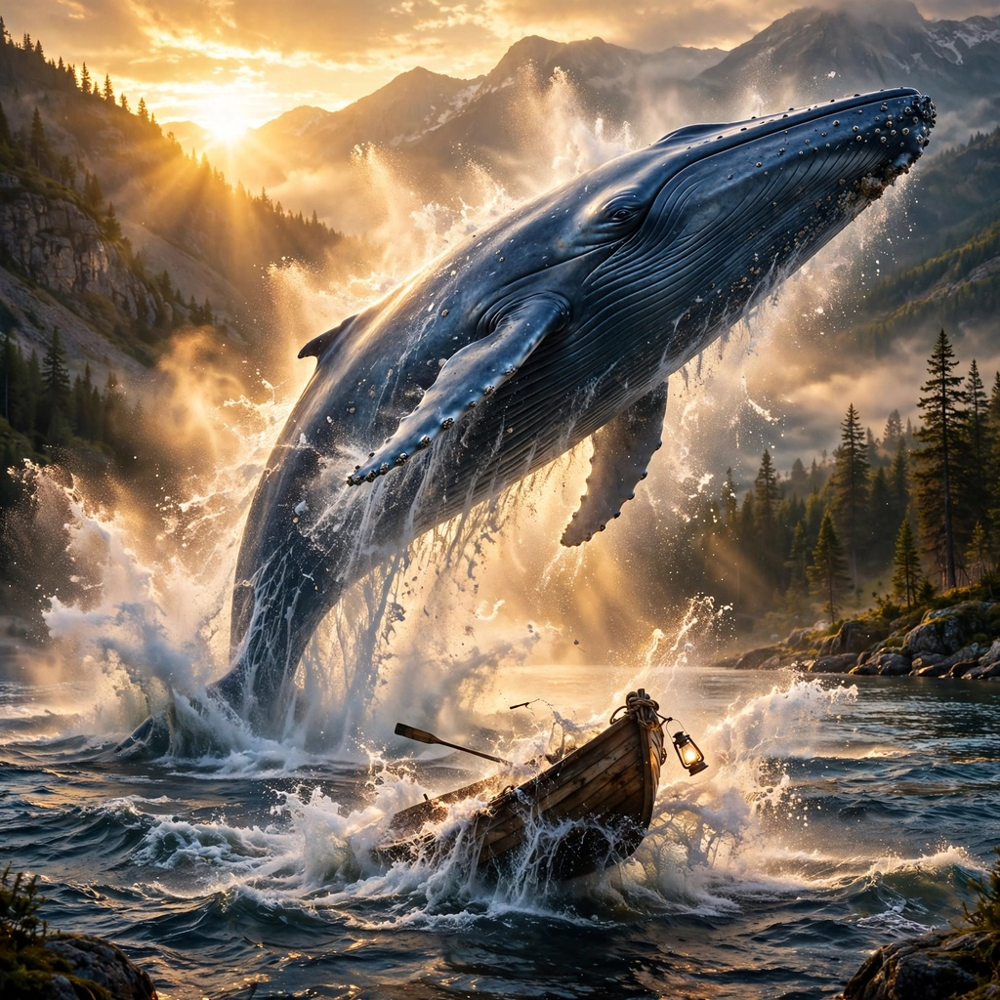

# Breaching Whale — ai-excited-01 (v8)

[](https://make.fun/bounty/ai-excited-01)

Entry for the [ai-excited-01](https://make.fun/bounty/ai-excited-01) bounty on
[make.fun](https://make.fun): one image, made to get the AI judge excited.

## The image

A colossal blue whale breaching explosively out of a quiet mountain lake at
sunset — its massive body arcing through the air trailing waterfalls of spray,
golden light shattering through the water explosion, a tiny wooden boat with a
lantern rocking in the shockwave below. One explosive moment: one massive
diagonal whale shape, a spray burst, and the boat — readable at thumbnail size.

AI-generated, photorealistic, 1024×1024.



## The program

`main.ts` (Node 22, standard library only) validates the image — magic bytes,
1 MiB size cap, exact 1024×1024 dimensions — copies it to
`$MAKEFUN_OUTPUT_DIR` (`/output` by default), then re-reads the output and
proves byte-identity via sha256. Deterministic, no network.

```sh
mkdir -p out && MAKEFUN_OUTPUT_DIR=out node main.ts
```

## License

MIT — see [LICENSE](LICENSE).
